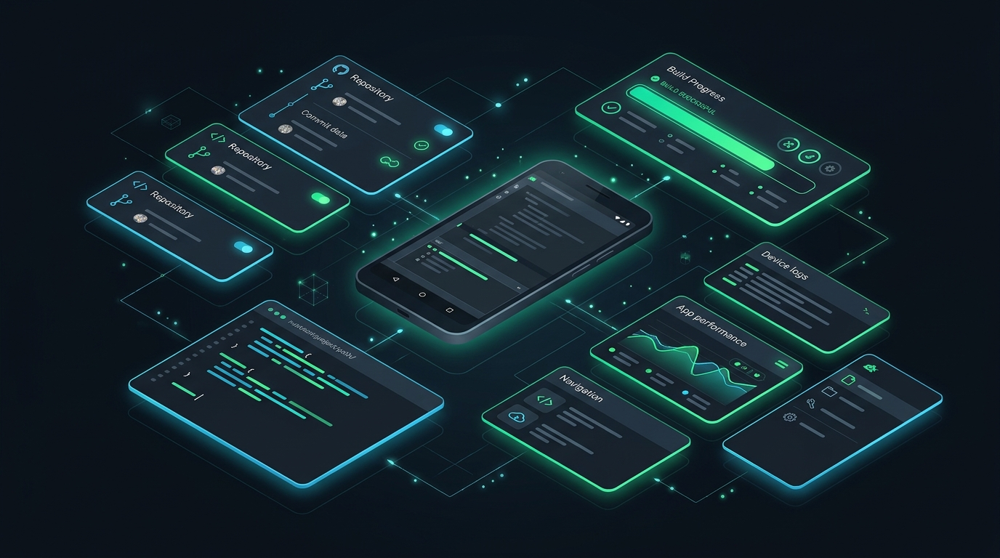
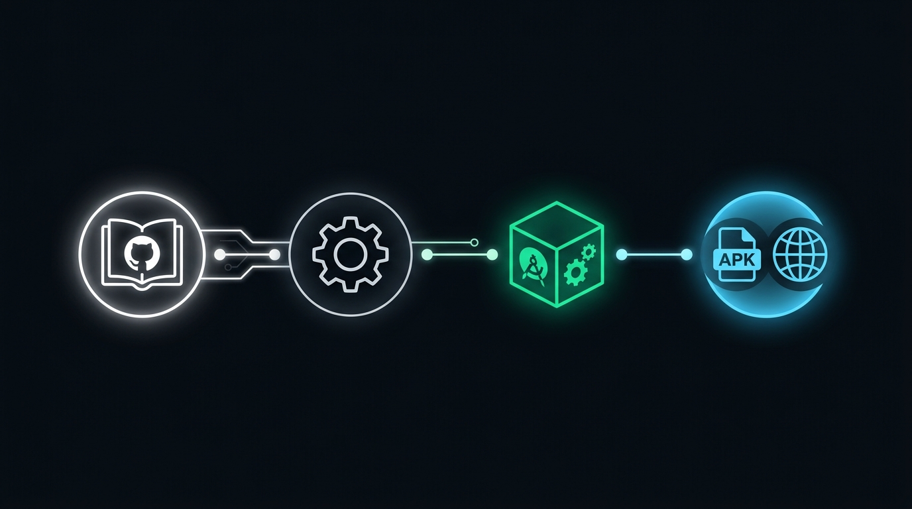

<div align="center">


# DroidForge

**মোবাইল থেকে সরাসরি GitHub Actions CI/CD নিয়ন্ত্রণ, Android APK বিল্ড, ও Vercel ওয়েব পোর্টাল জেনারেটর**  
*Mobile GitHub Actions CI/CD Console to inspect repositories, trigger Android APK builds, monitor live workflow steps, download release APKs, and publish Vercel download portals.*

[-00E59B?style=for-the-badge&logo=android&logoColor=002114)](https://developer.android.com/compose)
[](https://docs.github.com/en/actions)
[](https://vercel.com)

<br />


</div>

---

## অ্যাপের সংক্ষিপ্ত পরিচিতি (Overview)

**DroidForge** হলো একটি আধুনিক Material 3 (Obsidian CI Terminal) ডিজাইনের অ্যান্ড্রয়েড অ্যাপ, যা আপনার মোবাইল ফোন থেকেই **GitHub REST API** ও **GitHub Actions** ব্যবহার করে যেকোনো Android প্রজেক্টের ক্লাউড APK বিল্ড পরিচালনা করতে সাহায্য করে।

অ্যাপটির ভেতরেই **English** এবং **বাংলা** দুই ভাষায় ব্যবহার করার সুবিধা রয়েছে।

<div align="center">
  
</div>

---

## মূল ফিচারসমূহ (Key Features)

### ১. লাইভ GitHub রিপোজিটরি এক্সপ্লোরার (`Repos`)
- যেকোনো GitHub ইউজারনেম (যেমন `rsk934128-dot`), `owner/repo`, অথবা সম্পূর্ণ GitHub URL দিয়ে লাইভ রিপোজিটরি লোড করা যায়।
- **My Repos:** Settings-এ Personal Access Token (PAT) যুক্ত করলে এক ট্যাপেই নিজের পাবলিক ও প্রাইভেট রিপোজিটরি লোড করা যায়।
- **বুকমার্ক ক্যাশ:** Room Database ব্যবহার করে পছন্দের রিপোজিটরিগুলো লোকালি সেভ রাখা যায়।

### ২. ক্লাউড CI/CD বিল্ড ও রান ইন্সপেক্টর (`Builds`)
- রিপোজিটরির `.github/workflows` তালিকা ও সাম্প্রতিক বিল্ড রান (`queued`, `in_progress`, `success`, `failure`) লাইভ অটো-পোলিংসহ দেখায়।
- **Trigger Build (`workflow_dispatch`):** মোবাইল থেকেই ব্রাঞ্চ ও ওয়ার্কফ্লো সিলেক্ট করে নতুন APK বিল্ড চালু করা যায়।
- **জব ও স্টেপ লগ:** প্রতিটি বিল্ড রানের জব এবং স্টেপগুলোর সময় ও স্ট্যাটাস বিস্তারিতভাবে দেখা যায়, পাশাপাশি Re-run বা Cancel করা যায়।
- **APK ও আর্টিফ্যাক্ট ডাউনলোড:** GitHub Releases থেকে `.apk` ফাইল বা Actions Artifact `.zip` ফাইল সরাসরি ফোনের স্টোরেজে সেভ করা যায়।

### ৩. GitHub Actions YAML ও Vercel ওয়েব পোর্টাল স্টুডিও (`YAML / Studio`)
- **Actions YAML জেনারেটর:** `assembleDebug`, `assembleRelease`, বা `bundleRelease` টাস্ক, JDK (`17` / `21`), এবং অটো-রিলিজ অপশন দিয়ে `.github/workflows/android-apk.yml` তৈরি ও সরাসরি GitHub রিপোতে পুশ করা যায়।
- **Vercel ওয়েবসাইট পোর্টাল:** আপনার অ্যাপের APK ডাউনলোড পেজ (`index.html` + `vercel.json`) তৈরি করে এক ক্লিকে GitHub-এ পুশ করা যায়, যা GitHub Releases API থেকে সর্বশেষ APK ভার্সন ও ডাউনলোড লিংক স্বয়ংক্রিয়ভাবে দেখায়।

---

## ক্লাউড বিল্ড আর্কিটেকচার (Architecture)

<div align="center">
  
</div>

1. **Repository (`GitHubApiService`):** Retrofit + Moshi + OkHttp দিয়ে GitHub REST API v3-এর সাথে যোগাযোগ করে।
2. **Cloud Runner (`GitHub Actions`):** `ubuntu-latest` রানারে JDK ও Gradle সেটআপ করে APK কম্পাইল করে এবং GitHub Release-এ আপলোড করে।
3. **Local Cache (`Room` & `DataStore`):** বুকমার্ক করা রিপো, সাম্প্রতিক রান ক্যাশ, PAT, থিম এবং ভাষা পছন্দ নিরাপদে সংরক্ষণ করে।
4. **Web Portal (`Vercel`):** জেনারেট করা `vercel-site/index.html` এবং `vercel-site/vercel.json` GitHub রিপো থেকে সরাসরি Vercel-এ ডিপ্লয় করা যায়।

---

## টেক স্ট্যাক (Tech Stack)

| ক্যাটাগরি | ব্যবহৃত প্রযুক্তি |
| :--- | :--- |
| **Language & UI** | Kotlin, Jetpack Compose, Material Design 3 |
| **Architecture** | MVVM (`ViewModel` + `StateFlow`), Repository Pattern |
| **Networking** | Retrofit 2, OkHttp 4, Moshi (Codegen via KSP) |
| **Local Storage** | Room Database, Jetpack DataStore Preferences |
| **Media & Fonts** | Coil Compose, Bundled Google Fonts (`Space Grotesk`, `Plus Jakarta Sans`, `JetBrains Mono`) |
| **Testing** | JUnit 4, Robolectric |

---

## সেটআপ ও ব্যবহার নির্দেশিকা (Getting Started)

1. প্রজেক্টটি Android Studio বা Gradle দিয়ে ওপেন করে বিল্ড করুন:
   ```bash
   gradle assembleDebug
   ```
2. ইউনিট ও Robolectric টেস্ট চালান:
   ```bash
   gradle :app:testDebugUnitTest
   ```
3. অ্যাপটি ওপেন করে **Settings** ট্যাবে আপনার **GitHub Personal Access Token (`repo` ও `workflow` scope)** যুক্ত করুন (পাবলিক রিপো দেখার জন্য টোকেন ছাড়াও চলবে)।
4. **Repos** থেকে আপনার রিপোজিটরি সিলেক্ট করে **YAML / Studio** ট্যাব থেকে ওয়ার্কফ্লো পুশ করুন এবং **Builds** ট্যাব থেকে APK বিল্ড শুরু করুন।

---

## GitHub থেকে অটোমেটিক APK রিলিজ (GitHub Actions Release)

এই রিপোজিটরিতে আগে থেকেই `.github/workflows/release-apk.yml` যুক্ত করা আছে:
- `main` / `master` ব্রাঞ্চে কোড পুশ করলে অথবা `v*` ট্যাগ পুশ করলে, কিংবা **Actions -> Build & Release Android APK -> Run workflow** থেকে ম্যানুয়ালি চালালে স্বয়ংক্রিয়ভাবে `.apk` বিল্ড হয়ে **GitHub Releases**-এ প্রকাশিত হবে।
- **ডিফল্টভাবে কোনো Secret ছাড়াই** `debug.keystore.base64` ব্যবহার করে ইন্সটলেবল `debug` APK রিলিজ হবে।
- প্রোডাকশন **Release-signed APK** চাইলে রিপোজিটরির **Settings -> Secrets and variables -> Actions**-এ নিচের ৩টি Secret যুক্ত করুন:
  - `KEYSTORE_BASE64` (আপনার `.jks` ফাইলের Base64 টেক্সট)
  - `STORE_PASSWORD`
  - `KEY_PASSWORD`

---

## Vercel-এ ওয়েবসাইট হোস্টিং নির্দেশিকা

1. অ্যাপের **YAML** ট্যাবের উপরের সুইচার থেকে **Vercel ওয়েবসাইট** সিলেক্ট করুন।
2. আপনার অ্যাপের নাম, বিবরণ ও থিম অ্যাকসেন্ট দিয়ে **GitHub-এ ওয়েবসাইট পুশ করুন** বাটনে ট্যাপ করুন (`vercel-site/index.html` ও `vercel-site/vercel.json` কমিট হবে)।
3. [vercel.com](https://vercel.com)-এ গিয়ে **Add New Project** -> আপনার GitHub রিপোজিটরি Import করুন -> **Root Directory** হিসেবে `vercel-site` সেট করে **Deploy** করুন।
